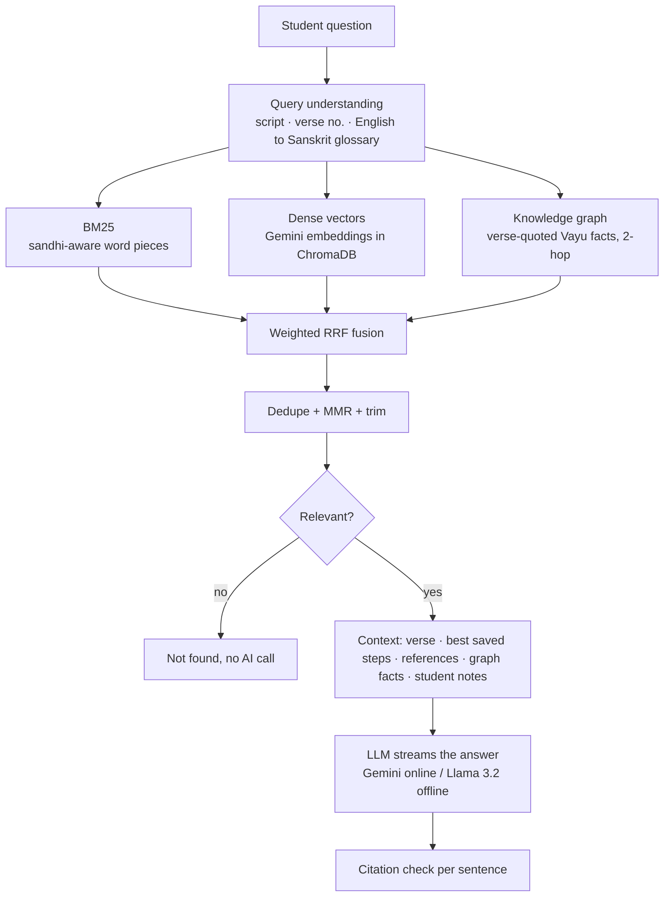

# Ayurvidya · आयुर्विद्या

**Study Sushruta Samhita, Nidana Sthana 1 (Vatavyadhi Nidana), verse by verse, with a grounded AI tutor.**

Every one of the chapter's 90 verses is opened in the seven classical study steps (Sampradanam,
Padavibhaga, Anvaya, Anvayartha, Bhavartha, Padakrityam, Dhvanitartha), written once by an AI from the
verse and its commentary, checked, and saved. A doubt-clearing chatbot answers questions from the same
sources only, with numbered footnotes, and says "not found" instead of guessing.

## What it does
- **Reading room:** the verse on a palm-leaf panel; tap any word for its form, meaning and root; the 7 steps as one reading; lamp-light night mode; works on a phone (installable web app).
- **Ask:** answers stream in word by word; every sentence cites its source; sentences the source does not support are marked.
- **Vayu map:** the five Vayus with their seats, actions and disorders, each fact quoting its verse.
- **My notes:** students upload their own translations in Excel; the tutor uses them for that student only.
- **Scholar desk:** scholars upload verse-quoted graph facts (CSV / Excel); the graph changes immediately.

## How the RAG works

The 7 steps are generated offline (Gemini, temperature 0): the verse and its commentary are pinned,
same-step examples from other verses are added (never the verse's own gold answer), every output is
validated and retried, then saved in SQLite. Students read the saved steps instantly.

## Results (current)
| Retrieval, 24 single-verse questions | Recall@5 | MRR |
|---|---|---|
| TF-IDF hybrid | 0.58 | 0.53 |
| Gemini embeddings hybrid + query expansion | 0.83 | 0.70 |

The knowledge graph raises Recall@5 on multi-verse questions from 0.54 to 0.84 (15 questions, being
re-checked by a scholar). Retrieval takes about 25 ms; the first word of an answer arrives in about 1.4 s.
Run `scripts/run_ablation.py` for the full table.

## Setup
```bash
python -m venv .venv
.venv\Scripts\activate            # Mac: source .venv/bin/activate
pip install -r requirements.txt
copy .env.example .env            # Mac: cp .env.example .env   - then fill in your keys
python scripts/build_kb.py
python scripts/share_answers.py import
python scripts/serve.py           # open the address it prints
python -m pytest -q
```
Offline chat with Llama: install Ollama, then `ollama pull llama3.2:3b` and
`ollama create ayurvidya-llama -f ollama/Modelfile`, and switch the chat lines in `.env`.

## Project map
| Folder / file | What it holds |
|---|---|
| `src/ayurvidya/` | query.py · index.py · embed.py · kg.py · retrieve.py · chatbot.py · verify.py · llm.py · pipeline.py · notes.py · kg_store.py · api.py |
| `web/` | the reading-room app (index.html, app.js, style.css) and the scholar desk (scholar.html) |
| `data/` | mula text, gold annotations, sources, glossary (`synonyms.csv`), graph facts (`kg/facts.csv`), test questions (`eval/`) |
| `prompts/` | the step prompts, the chatbot prompt and the extraction prompts |
| `scripts/` | build, generate, review, share, benchmark, compare and ablation scripts |

## Evaluation scripts
`compare_embedders.py` (embedders, stores, expansion) · `run_ablation.py` (retrieval ablation,
single- vs multi-verse) · `compare_chat_models.py` (Gemini vs Llama) · `chat_benchmark.py` (latency) ·
`quality_report.py` (chrF per step against gold) · `compute_cvi.py` (scholar ratings).

## Deploy
`render.yaml` deploys the API and app on Render. Set the keys, `DATABASE_URL` (Supabase Postgres) and the
access codes under Environment. Uploaded notes and scholar facts live in Postgres, so they survive restarts.

## Data and safety
API keys live only in `.env` and Render settings, never in Git. Answers are a study aid, not medical advice.